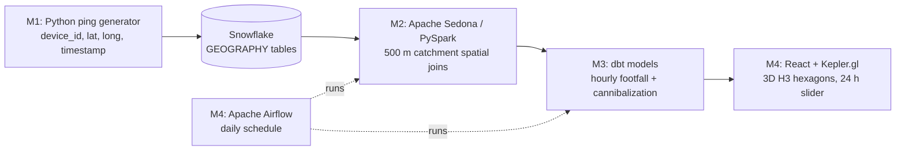

# GeoPulse: Hyper-Local Retail Mobility Analytics

> Infotact Solutions, Advanced Data Analytics (Vol. II), Project 2

GeoPulse turns anonymized mobile GPS pings into a footfall map that shows how people move through a city across the day. A retailer can test a new store location and see how much traffic it would take from an existing store (**cannibalization**) before signing a lease.

**Example:** a coffee chain considers opening "Store B" on 5th Street. GeoPulse shows that Store B would intercept about 30% of the morning commuter traffic that currently walks to "Store A", so the real estate director picks a different neighborhood.

---

## Problem statement

Retailers often choose new store locations from static census data. They lack dynamic insight into how foot traffic actually flows through a city during the day, and they sometimes open a store that cannibalizes the sales of an existing one.

## Solution

An end-to-end geospatial data pipeline:

1. Generate a large mock dataset of anonymized device pings that mimics city movement.
2. Store it in Snowflake using native `GEOGRAPHY` types.
3. Use Apache Sedona (PySpark) to join pings to 500 m store catchment polygons at scale.
4. Use dbt to aggregate hourly footfall per store and compute cannibalization.
5. Show the results in an animated 3D map (Kepler.gl inside a React app).
6. Orchestrate the daily refresh with Apache Airflow.

---

## Architecture



## Tech stack

| Layer | Tool |
|---|---|
| Data synthesis | Python, NumPy, Pandas, Parquet |
| Data warehouse | Snowflake (`GEOGRAPHY` data type) |
| Spatial processing | Apache Sedona on PySpark |
| Transformation | dbt (runs inside Snowflake) |
| Visualization | Kepler.gl embedded in React, H3 hexagons |
| Orchestration | Apache Airflow |
| Tooling | Git, GitHub, VS Code, pytest |

---

## Team

| Member | Role | Owns | Branch |
|---|---|---|---|
| **M1** (Team Lead) | Data Synthesis & Snowflake | `data_synthesis/`, `docs/` | `m1-data-snowflake` |
| **M2** | Spatial Processing | `spark_jobs/` | `m2-sedona-spatial` |
| **M3** | dbt Modeling | `dbt_project/` | `m3-dbt-models` |
| **M4** | Dashboard & Automation | `dashboard/`, `airflow/` | `m4-dashboard-airflow` |

**Handoff order:** M1 data → M2 spatial join → M3 dbt tables → M4 dashboard.

### What each member delivers

**M1: Data Synthesis & Snowflake**
- Mock GPS ping generator (commuters with home and work locations, morning and evening rush hours, GPS noise)
- Store locations (Store A existing, Store B proposed, Store C control) and commercial zoning polygons
- Snowflake database, tables with `GEOGRAPHY` columns, and a bulk loader
- Pipeline audit script and the data contract for the team

**M2: Spatial Processing**
- Java, PySpark and Apache Sedona environment
- 500 m catchment polygons around each store
- Spatial join of pings with catchments
- Memory audit proving the job handles millions of points

**M3: dbt Modeling**
- dbt project connected to Snowflake
- Hourly unique visitors per store
- Cannibalization SQL (percentage of devices visiting more than one store)
- Data integrity tests (morning vs. evening traffic spikes)

**M4: Dashboard & Automation**
- React app with Kepler.gl connected to the Snowflake aggregate tables
- 3D H3 hexagons and a 24-hour animation slider
- Airflow DAG that runs the Spark and dbt jobs daily

---

## Repository structure

```
geopulse-retail-mobility/
├── data_synthesis/     # M1: ping generator, Snowflake loader, pipeline audit
├── spark_jobs/         # M2: Apache Sedona / PySpark spatial joins
├── dbt_project/        # M3: dbt models (staging, marts)
├── airflow/dags/       # M4: orchestration DAGs
├── dashboard/          # M4: React + Kepler.gl app
├── docs/               # sample data, store and zone files, Snowflake SQL, guides
├── tests/              # pytest tests
├── data/               # generated data (gitignored, never committed)
├── .env.example        # credentials template (copy to .env)
├── requirements.txt
└── README.md
```

---

## Data

### Ping dataset (`DEVICE_PINGS`)

| Column | Type | Description |
|---|---|---|
| `device_id` | string | Anonymized device identifier |
| `lat` | float | Latitude |
| `long` | float | Longitude |
| `timestamp` | timestamp (UTC) | Time of the ping |
| `location` | GEOGRAPHY | Point built in Snowflake with `ST_MAKEPOINT(long, lat)` |

> **Note:** `ST_MAKEPOINT` takes **longitude first**, then latitude. Swapping them is the most common bug in geospatial work.

### Reference data

| File | Content |
|---|---|
| `docs/store_locations.csv` | Store A (existing), Store B (proposed), Store C (control) |
| `docs/commercial_zones.geojson` | Commercial zoning polygons |
| `docs/sample_pings_1000.csv` | 1,000-row sample so teammates can start immediately |

### About the synthetic data
The data is **synthetic by design**: it respects privacy and lets us control the scenario. Devices have a home and a work location, commute in the morning (8-9 am) and evening (5-6 pm), and are mostly stationary at other times. A known share of Store A's morning commuters also pass Store B, which gives the team a measurable cannibalization value (about 30%) to validate their SQL against.

---

## Getting started

### Prerequisites
- Python 3.10+
- Git and VS Code
- A free [Snowflake trial account](https://signup.snowflake.com/)
- Java 11 or 17 (M2 only, for Spark and Sedona)
- Node.js (M4 only, for the dashboard)

### Setup

```bash
git clone https://github.com/<owner>/geopulse-retail-mobility.git
cd geopulse-retail-mobility

python -m venv venv
source venv/bin/activate          # Windows: venv\Scripts\activate
pip install -r requirements.txt

cp .env.example .env              # Windows: copy .env.example .env
```

Fill in your Snowflake details in `.env`. **Never commit `.env`.**

### Generate the data

```bash
python data_synthesis/generate_pings.py --devices 50000 --days 5
```

Run with `--help` to see all options. The output is written as Parquet files under `data/` (gitignored).

### Create the Snowflake objects

Run `docs/snowflake_setup.sql` in a Snowflake worksheet. It creates the warehouse (X-Small, auto-suspend), the database, the schemas and the tables with `GEOGRAPHY` columns.

### Load and verify

```bash
python data_synthesis/load_to_snowflake.py
python data_synthesis/pipeline_check.py
```

The audit prints PASS or FAIL for each check (row counts, no null locations, morning and evening peaks, bounding box, pings near each store) and writes the results to `docs/pipeline_audit.md`.

### Run the tests

```bash
pytest
```

---

## Roadmap

| Week | Spatial Data Engineering | Geospatial BI |
|---|---|---|
| **1** | Generate the mock ping dataset | Set up Snowflake, `GEOGRAPHY` tables, load the data |
| **2** | Sedona: 500 m catchments and spatial joins | dbt: hourly unique visitors per store |
| **Mid-project review** | Spatial audit: millions of points without running out of memory | Data integrity check: morning vs. evening spikes |
| **3** | Cannibalization logic in dbt | Kepler.gl map in React, connected to Snowflake |
| **4** | Airflow daily orchestration | 3D H3 hexagons and a 24-hour slider |
| **Final review** | Specialized geospatial pipeline at scale | Interactive 3D map for real estate decisions |

## Progress

- [x] Repo structure, README and `.gitignore`
- [x] Mock GPS ping generator, store and zone files, sample data, tests
- [ ] Snowflake tables created and full data loaded
- [ ] Pipeline audit passing
- [ ] Sedona spatial joins (M2)
- [ ] dbt models and cannibalization SQL (M3)
- [ ] Kepler.gl dashboard (M4)
- [ ] Airflow DAG (M4)
- [ ] Final demo and documentation

---

## Team workflow

1. Each member works on **their own branch**. Nobody commits directly to `main`.
2. Commit small and often, using these prefixes: `feat:`, `fix:`, `docs:`, `test:`, `chore:`.
3. Open a **Pull Request** into `main` and ask a teammate to review it.
4. After a merge, everyone updates their branch:

```bash
git checkout main
git pull origin main
git checkout <your-branch>
git merge main
```

5. **Never commit** `.env`, credentials, or large data files.

## Troubleshooting

| Problem | Fix |
|---|---|
| Points appear in the wrong place on the map | Check that you used longitude first in `ST_MAKEPOINT(long, lat)` |
| Snowflake login fails | Check the account identifier format in `.env` and that your trial is active |
| Out of memory while generating data | Lower `--devices`, or generate in smaller chunks |
| `git push` rejected | Run `git pull origin <your-branch>`, then push again |

## Business impact

Every output is designed to drive an action: choosing a store location that adds new customers instead of splitting the existing ones.

## License

MIT